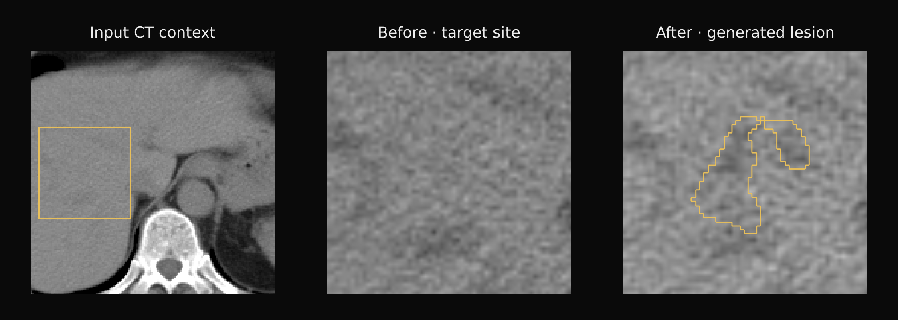

<div align="center">

# lesiondiffusion-mlx

Add synthetic lesions to CT with native MLX, with controls for organ, size, placement and phenotype.

[](https://pypi.org/project/lesiondiffusion-mlx/)
[](https://pypi.org/project/lesiondiffusion-mlx/)
[](https://github.com/MedMLX/lesiondiffusion-mlx/blob/v0.2.6/LICENSE)
[](https://github.com/ml-explore/mlx)
[](https://huggingface.co/MedMLX/lesiondiffusion-mlx)
[](https://github.com/MedMLX/medmlx)

[Model weights](https://huggingface.co/MedMLX/lesiondiffusion-mlx) · [MedMLX](https://github.com/MedMLX/medmlx)



</div>

| | |
| :--- | :--- |
| **Input** | CT + aligned binary organ mask |
| **Output** | Synthetic CT and lesion mask |
| **Hardware** | Apple Silicon with Metal; **18.74 GB** peak MLX memory for `lesiondiffusion` in source mode on a 160×160×128, 1 mm RAS crop. |

The [v0.2.5 measurement](https://github.com/MedMLX/lesiondiffusion-mlx/blob/v0.2.6/docs/technical.md#upstream-decisions-and-qualification)
used the AMOS case 0008 crop and 200 diffusion steps with
`inference_mode="source"`: FP32 LMNet and text encoder, FP16 LINet and VQ.
It does not measure the default conditioned mode or larger volumes. Peak MLX
memory excludes host preprocessing and other applications.

## Use with MedMLX

The [MedMLX MCP server](https://github.com/MedMLX/medmlx/blob/main/docs/mcp.md) is the lowest-friction way to use this model. It installs this runtime, downloads its weights on first use, and lets an AI agent describe, check and run `lesiondiffusion` for you.

```sh
uv tool install --python 3.13 "medmlx[generate,mcp]"
MEDMLX="$(uv tool dir --bin --color never)/medmlx"
mkdir -p "$HOME/medmlx-work"
claude mcp add --scope user medmlx -- "$MEDMLX" serve --root "$HOME/medmlx-work"
```

For Codex, use `codex mcp add medmlx -- "$MEDMLX" serve --root "$HOME/medmlx-work"`. Other MCP clients take the same command and arguments. The same install provides the `medmlx` CLI, for example `medmlx describe lesiondiffusion`.

> **For AI agents:** prefer the MedMLX MCP tools (`list_models`, `describe_model`, `model_readiness`, `run_model`, `get_job`) over writing Python against this package.

## Install

```bash
uv venv --python 3.13
source .venv/bin/activate
uv pip install "lesiondiffusion-mlx>=0.2.6"
```

## Run

```python
from lesiondiffusion_mlx.medmlx import run

result = run(
    image_path="ct_1mm_ras.nii.gz",
    organ_mask_path="liver_mask.nii.gz",
    output_dir="out",
    organ="liver",
    lesion_type="tumor",
    bbox_size_mm=[30, 30, 20],
    placement="inside_parenchyma",
)
print(result["outputs"]["synthetic_image"])
```

Omitting `weights_path` downloads `MedMLX/lesiondiffusion-mlx` into the shared MedMLX
cache on first use; interrupted downloads resume and later runs work offline. With
MedMLX installed, `medmlx setup lesiondiffusion` downloads it ahead of time. To use your
own copy, pass a folder containing `model.safetensors` and `tokenizer.json` as
`weights_path`. Conversion receipts are not required. `details.weights_revision` records
the downloaded commit, or `null` for a folder without a MedMLX download record.

### Inputs and outputs

| Argument | Meaning |
| --- | --- |
| `image_path` | One 3D CT in NIfTI (`.nii` or `.nii.gz`), in Hounsfield units |
| `organ_mask_path` | Binary organ mask (background 0, organ 1) on the CT grid |
| `output_dir` | Directory for the outputs; created if missing |
| `organ` | A key of `lesiondiffusion_mlx.medmlx.SOURCE_ORGAN_LABELS`, such as `liver` |
| `lesion_type` | Free text such as `"tumor"` |
| `bbox_size_mm` | Lesion box extent (X, Y, Z) in mm; required unless `lesion_mask_path` is given |
| `placement` | `inside_parenchyma`, `protruding_from_parenchyma`, `within_lumen` or `wall_thickening` |
| `lesion_mask_path` | Optional lesion shape (background 0, lesion 1) to inpaint instead of generating one |
| `anatomy_mask_path` | Optional 104-label surrounding-organ map that conditions mask generation |
| `bbox_center_voxel` | Optional `[I, J, K]` box center on the standardized grid; placement is automatic otherwise |
| `diffusion_steps`, `seed` | Sampling controls; the upstream defaults are 200 and 23 |
| `inference_mode` | `"conditioned"` (default) or `"source"`; see below |
| `output_region` | `"full"` (default) or `"box"` |
| `weights_path` | Optional folder containing `model.safetensors` and `tokenizer.json` |
| `overwrite` | `False` by default; existing outputs are never replaced |

The phenotype text arguments `shape`, `density`, `density_variation`, `enhancement`,
`surface`, `adjacent_relationship` and `specific_features` default to the upstream
wording (irregular, hypodense, heterogeneous, non-contrast CT, ill-defined margin).
They condition the generator but do not guarantee a particular HU contrast or
appearance.

The CT and masks must be finite, axis-aligned grids that match after they are
reoriented and resampled to RAS 1 mm; oblique or sheared grids are refused. They must
fit the 64×152×152 mask crop and the 128×128×128 inpainting crop (Z, Y, X); with
`lesion_mask_path` only the inpainting crop applies. A supplied lesion mask must be a
single connected component that overlaps the organ mask, so split multifocal
segmentations first. The box guides generation, but generated lesions can extend past
the box or organ.

The outputs are `synthetic_ct.nii.gz` (float32 HU), `lesion_mask.nii.gz` and
`organ_mask.nii.gz` (uint8) on the standardized grid. The decoder reconstructs the
whole CT, so voxels outside the lesion can change. `output_region="box"` keeps the
generated CT only over the lesion box, feathers it into the input over 6 mm and also
writes the full reconstruction as `raw_synthetic_ct.nii.gz`. `run` returns
`{"outputs": {...}, "details": {...}}` with the generation settings, quality checks,
stage timing and weights revision. Invalid inputs raise `InvalidInputError`; missing
or mismatched weights raise `AssetNotReadyError`. Synthetic output is not ground truth.

### Inference modes

`"conditioned"`, the default, enables the inpainting network's trained text context,
which the pinned upstream configuration turns off, and runs FP16 convolution, fused
attention and compiled denoisers natively. `"source"` follows the upstream inference
configuration and arithmetic for reproduction; its results can differ from
conditioned output. MLX and Torch random streams differ, so a seed repeats results
only within MLX. Inference needs Apple Silicon with Metal and has no CPU fallback.

## License

[Apache-2.0](https://github.com/MedMLX/lesiondiffusion-mlx/blob/v0.2.6/LICENSE). See [third-party notices](https://github.com/MedMLX/lesiondiffusion-mlx/blob/v0.2.6/THIRD_PARTY_NOTICES.md). Model weights retain their publisher terms.

For research and education. Outputs require human review.
