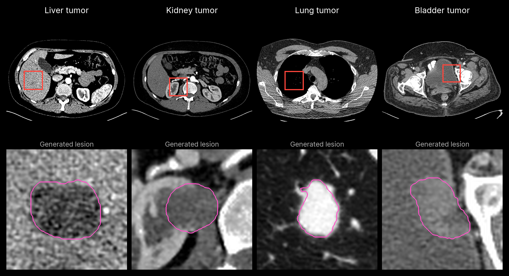

<div align="center">

# lesiondiffusion-mlx

Add synthetic lesions to CT with native MLX, with controls for organ, size, placement and phenotype.

[](https://pypi.org/project/lesiondiffusion-mlx/)
[](https://pypi.org/project/lesiondiffusion-mlx/)
[](https://github.com/MedMLX/lesiondiffusion-mlx/blob/v0.4.1/LICENSE)
[](https://github.com/ml-explore/mlx)
[](https://huggingface.co/MedMLX/lesiondiffusion-mlx)
[](https://github.com/MedMLX/medmlx)



<sub>Source CT from [KiTS23](https://kits-challenge.org/kits23/), CC BY-NC-SA 4.0, and [LUNA16](https://zenodo.org/records/3723295), CC BY 4.0.</sub>

</div>

| Input | Output |
| :--- | :--- |
| CT + aligned binary organ mask | Synthetic CT and lesion mask |

| Model | Weights download | Peak MLX memory | Measured on |
| :--- | ---: | ---: | :--- |
| `lesiondiffusion`, conditioned mode (default) | 1.7 GB | 5.19 GB | M5 Max, 160×160×128, 1 mm RAS crop, 200 diffusion steps |
| `lesiondiffusion`, conditioned mode (default) | 1.7 GB | 7.58 GB | M1 Max (64 GB), 160×160×128, 1 mm RAS crop, 200 diffusion steps |
| `lesiondiffusion`, source mode | 1.7 GB | 3.46 GB | M5 Max, 160×160×128, 1 mm RAS crop, 200 diffusion steps |
| `lesiondiffusion`, conditioned mode (default) | 1.7 GB | 92.4 GB | M1 Max (64 GB), 440×440×248, 1 mm RAS, 200 diffusion steps |
| `lesiondiffusion`, conditioned with `vq_mode="slab"` | 1.7 GB | 2.81 GB | M1 Max (64 GB), 440×440×248, 1 mm RAS from a 512×512×99 abdominal CT, 20 diffusion steps |

In the default mode, memory grows with the standardized 1 mm volume, because the
whole volume is encoded and decoded. For a large CT, either crop the CT and organ
mask together on the same grid, or pass `vq_mode="slab"` to reconstruct the full
volume with less MLX memory. The slab path needs temporary disk space on `TMPDIR`
or the system temp volume: allow 56 GB free for a 440×440×248 grid.

The [technical notes](https://github.com/MedMLX/lesiondiffusion-mlx/blob/main/docs/technical.md)
give the precision of each network in these measurements.

## Install

```bash
uv venv --python 3.13
source .venv/bin/activate
uv pip install "lesiondiffusion-mlx>=0.4.1"
```

## Run

```python
from lesiondiffusion_mlx import run

result = run(
    image_path="ct_1mm_ras.nii.gz",
    organ_mask_path="liver_mask.nii.gz",
    output_dir="out",
    organ="liver",
    lesion_type="tumor",
    bbox_size_mm=[30, 30, 20],
    placement="inside_parenchyma",
    output_region="lesion",
)
print(result["outputs"]["image"])
```

The synthetic CT is written on the standardized RAS 1 mm grid. `output_region="lesion"`
limits changes to the neighborhood of the lesion; the default `"full"` reconstructs the
whole volume (see below).

Weights download from `MedMLX/lesiondiffusion-mlx` on first use; `medmlx setup lesiondiffusion`
downloads them ahead of time. To use your own copy, pass a folder containing
`model.safetensors` and `tokenizer.json` as `weights_path`.

### Inputs and outputs

| Argument | Meaning |
| --- | --- |
| `image_path` | One 3D CT in NIfTI (`.nii` or `.nii.gz`), in Hounsfield units |
| `organ_mask_path` | Binary organ mask (background 0, organ 1) on the CT grid |
| `output_dir` | Directory for the outputs; created if missing |
| `organ` | A key of `lesiondiffusion_mlx.medmlx.SOURCE_ORGAN_LABELS`, such as `liver` |
| `lesion_type` | Free text such as `"tumor"` |
| `bbox_size_mm` | Lesion box extent (X, Y, Z) in mm; required unless `lesion_mask_path` is given |
| `placement` | `inside_parenchyma`, `protruding_from_parenchyma`, `within_lumen` or `wall_thickening` |
| `lesion_mask_path` | Optional lesion shape (background 0, lesion 1) to inpaint instead of generating one |
| `anatomy_mask_path` | Optional 104-label surrounding-organ map that conditions mask generation |
| `bbox_center_voxel` | Optional `[I, J, K]` box center on the standardized grid; placement is automatic otherwise |
| `diffusion_steps`, `seed` | Sampling controls; the upstream defaults are 200 and 23 |
| `lmnet_diffusion_steps`, `linet_diffusion_steps` | Optional stage overrides; each defaults to `diffusion_steps` |
| `sampler` | `"ddim"` (default) or `"dpmpp_2m"` in conditioned mode |
| `decoder_mode` | `"reference"` (default) or `"scaled_fp16"` with conditioned mode and enabled NAX |
| `vq_mode` | `"whole"` (default) or `"slab"` in conditioned mode with the reference decoder. Slab mode uses temporary files for VQ activations and supports all output regions |
| `inference_mode` | `"conditioned"` (default) or `"source"`; see below |
| `output_region` | `"full"` (default), `"box"` or `"lesion"`; see below |
| `weights_path` | Optional folder containing `model.safetensors` and `tokenizer.json` |
| `overwrite` | `False` by default; existing outputs are never replaced |

For repeated seeds or phenotype controls on one supplied lesion outline, load the
model once. Its `run` takes the same arguments without `weights_path`, the box
and the anatomy map, and returns what the one-shot call would:

```python
from lesiondiffusion_mlx import load_model

with load_model() as model:
    for seed in (1, 2, 3):
        model.run(
            image_path="ct.nii.gz", organ_mask_path="liver.nii.gz",
            lesion_mask_path="lesion.nii.gz", output_dir=f"out/seed-{seed}",
            organ="liver", lesion_type="tumor", placement="inside_parenchyma",
            output_region="lesion", seed=seed,
        )
```

The CT, masks, weights, organ, inference mode, decoder mode, VQ mode and output
region stay fixed after the first draw; each draw builds fresh text conditioning
and sampler state.

To choose among lesion shapes before inpainting, `draw_lesion_masks` samples one
mask per seed in a fixed box and writes nothing. It takes the arguments of `run`
that LMNet uses, plus required `bbox_center_voxel` and `seeds`, and returns one
boolean array per seed on the standardized grid. Each equals the `mask` output of
`run` with that seed; pass a chosen mask to `run` as `lesion_mask_path`.

```python
from lesiondiffusion_mlx import draw_lesion_masks

masks = draw_lesion_masks(
    image_path="ct.nii.gz", organ_mask_path="liver.nii.gz", organ="liver",
    lesion_type="tumor", bbox_size_mm=[30, 30, 20],
    bbox_center_voxel=[80, 80, 64], seeds=[1, 2, 3],
)
```

- **Stage steps:** `lmnet_diffusion_steps=200, linet_diffusion_steps=50` keeps
  200-step mask generation and uses 50-step CT inpainting. For the same seed the
  mask is unchanged and the CT differs. Results record the requested and actual
  steps of each stage.
- **Sampler:** `"dpmpp_2m"` is deterministic DPM-Solver++ 2M with exactly the
  requested number of denoiser calls per attempt (1–999); mask QC can request a
  second attempt. It changes both sampling trajectories. Source mode uses DDIM.
- **Decoder:** `"scaled_fp16"` keeps FP32 codebook selection and runs the decoder
  in scaled half precision, which prevents the upsampling overflow and changes
  decoded HU by half rounding. It needs the neural accelerators of an M5 or later
  GPU and caps MLX's free-buffer cache at 4 GiB during generation. `"reference"`
  decodes in FP32. Measurements are in the
  [technical notes](https://github.com/MedMLX/lesiondiffusion-mlx/blob/main/docs/technical.md).

[LesionControl](https://github.com/MedMLX/lesiondiffusion-mlx/blob/main/research/lesioncontrol/README.md),
in `research/lesioncontrol` with its own environment, adds reference-conditioned
radiomics profiles, bounded control search and a learned context adapter.

**Phenotype text.** `shape`, `density`, `density_variation`, `enhancement`, `surface`,
`adjacent_relationship` and `specific_features` default to the upstream wording
(irregular, hypodense, heterogeneous, non-contrast CT, ill-defined margin). They
condition the generator but do not guarantee a particular HU contrast or appearance.

**Input geometry**

- The CT and masks must be finite, axis-aligned grids that match after they are
  reoriented and resampled to RAS 1 mm; oblique or sheared grids are refused.
- They must fit the 64×152×152 mask crop and the 128×128×128 inpainting crop (Z, Y, X);
  with `lesion_mask_path` only the inpainting crop applies.
- A supplied lesion mask must be a single connected component that overlaps the organ
  mask, so split multifocal segmentations first.
- Mask files must be 3D real-valued NIfTI-1 or NIfTI-2 files. Spatial units of meter
  or micron are converted to millimeters; any other unit code, a 2D, complex or
  boolean mask, or another file format raises `InvalidInputError`.
- The box guides generation, but generated lesions can extend past the box or organ.

**Outputs.** `synthetic_ct.nii.gz` (float32 HU), `lesion_mask.nii.gz` and
`organ_mask.nii.gz` (uint8) on the standardized grid. The decoder reconstructs the whole
CT, and that reconstruction does not reproduce the input exactly: away from the lesion
it shifts attenuation by several HU, by an amount that depends on the volume.
`output_region` controls how much of it reaches `synthetic_ct.nii.gz`:

| `output_region` | `synthetic_ct.nii.gz` holds |
| :--- | :--- |
| `"full"` (default) | The reconstruction, as upstream writes it, so every voxel can change |
| `"box"` | The reconstruction over the lesion box, feathered into the input over 6 mm. Tissue inside the box keeps the shift |
| `"lesion"` | Also decodes the unchanged input, and adds only the difference between the two decodes to the input CT, within 33 voxels of the lesion along each axis. The shift cancels, and voxels farther away are the input unchanged. Use it when the surrounding anatomy should keep its measured values |

`"box"` and `"lesion"` also write the full reconstruction as `raw_synthetic_ct.nii.gz`.
`run` returns `{"outputs": {...}, "artifacts": {...}, "details": {...}}`. The output
roles are `image`, `mask` and `organ_mask`, plus `raw_image` for `"box"` and `"lesion"`;
`artifacts` describes each file and `details` holds run metadata.
Invalid inputs raise `InvalidInputError`; missing
or mismatched weights raise `AssetNotReadyError`.

### Inference modes

| `inference_mode` | Behavior |
| :--- | :--- |
| `"conditioned"` (default) | Enables the inpainting network's trained text context, which the pinned upstream configuration turns off, and runs FP16 convolution, fused attention and compiled denoisers natively. Decodes in FP32, because the decoder's activations can exceed the FP16 range on some volumes |
| `"source"` | Follows the upstream inference configuration and arithmetic for reproduction, including FP16 decoding; when that overflows, the run raises an error instead of writing a CT. Results can differ from conditioned output |

MLX and Torch random streams differ, so a seed repeats results only within MLX.

## Use with MedMLX

Use the [MedMLX MCP server](https://github.com/MedMLX/medmlx/blob/main/docs/mcp.md) to run `lesiondiffusion` from an MCP client. Weights download on first use.

```sh
uv tool install --python 3.13 "medmlx[generate,mcp]"
MEDMLX="$(uv tool dir --bin --color never)/medmlx"
mkdir -p "$HOME/medmlx-work"
claude mcp add --scope user medmlx -- "$MEDMLX" serve --root "$HOME/medmlx-work"
```

For Codex, use `codex mcp add medmlx -- "$MEDMLX" serve --root "$HOME/medmlx-work"`. Other MCP clients take the same command and arguments. The same install provides the `medmlx` CLI, for example `medmlx describe lesiondiffusion`.

> **For AI agents:** prefer the MedMLX MCP tools (`list_models`, `describe_model`, `model_readiness`, `run_model`, `get_job`) over writing Python against this package.

## License

[Apache-2.0](https://github.com/MedMLX/lesiondiffusion-mlx/blob/v0.4.1/LICENSE). See [third-party notices](https://github.com/MedMLX/lesiondiffusion-mlx/blob/v0.4.1/THIRD_PARTY_NOTICES.md). Model weights retain their publisher terms.
